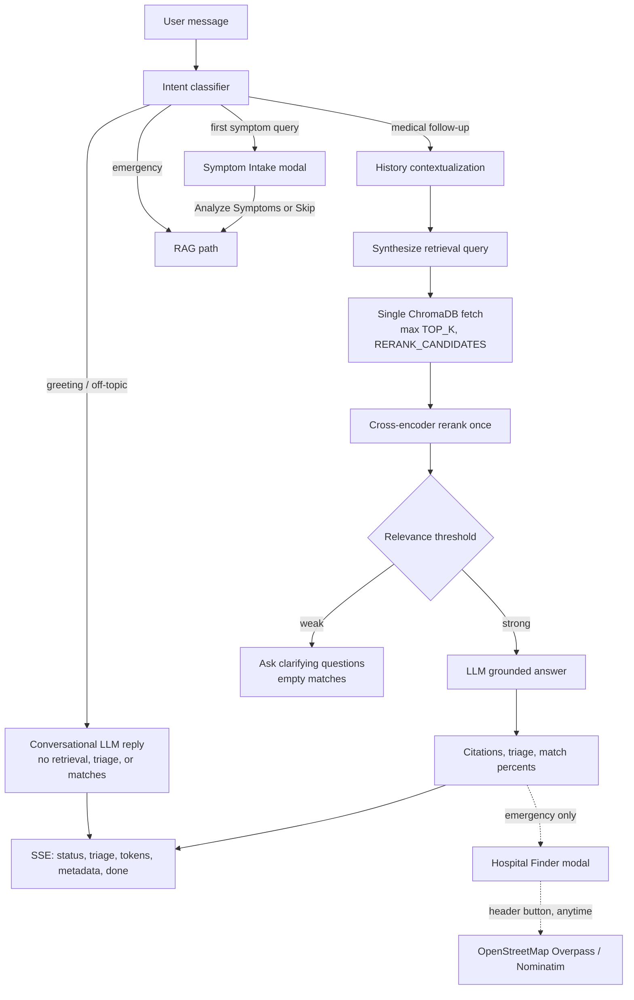

# MediAssist — Medical Diagnosis Assistant using LLM + RAG

MediAssist is a research and academic medical **information** assistant. A user describes symptoms in everyday language—by typing, or by tapping a body map and choosing symptom chips—and the system looks up matching notes from a curated knowledge base. It then returns grounded information with citations, a triage label (self-care, consult a doctor, or emergency), and possible condition matches. Nearby hospitals are available on demand from the chat header. It is **not** a medical device and does **not** replace a doctor: it does not give a confirmed diagnosis, prescribe medicines, or suggest doses.

The website is **React 19**, **TypeScript**, **Vite**, and **Tailwind CSS**. The backend is **FastAPI** with **JWT cookie** auth and **MongoDB** (or an in-memory stand-in for local demos). Medical notes stay as markdown files; search uses **ChromaDB**.

---

## Features

- Intent routing: greetings stay canned; general, coding, travel, and comparison questions use the configured LLM without medical cards; medical questions use RAG
- Multi-turn chat history (last 8–10 messages) for follow-up symptoms and “tell me more”
- Conditional **Symptom Intake** modal (duration, age group, aggravating factors) only on the first symptom query
- Standalone **Hospital Finder** modal from the chat header; emergency replies also get a compact hospital shortcut
- Interactive body map on a new chat and from the **Body** button (not a diagnosis)
- SSE streaming with live status text, markdown rendering, and auto-scroll
- RAG over about 1000 curated medical notes with MiniLM embeddings, ChromaDB, and a cross-encoder re-ranker
- Safety guardrails for emergency language and prescription/dosage refusal
- Pluggable LLM providers: `mock`, `groq`, `openai`, `ollama`
- Evaluation scripts for embeddings, triage, hallucination, and end-to-end quality

---

## Architecture



The live chat never answers from the model alone for medical queries. Retrieval, triage, and guardrails stay in the path unless the intent classifier labels the turn as conversational.

---

## Repository layout

```
project-root/
├── backend/
│   ├── app/                    # FastAPI HTTP layer
│   │   ├── api/routes/         # auth, chats, messages, hospitals
│   │   ├── connection/         # MongoDB client and indexes
│   │   ├── core/               # config, security, errors
│   │   ├── models/             # user, chat, message documents
│   │   ├── repositories/
│   │   ├── schemas/
│   │   └── services/           # auth, chat, RAG orchestration + history
│   └── src/                    # RAG pipeline (keep this tree)
│       ├── ai/providers/       # mock, groq, openai, ollama
│       ├── embeddings/
│       ├── llm/
│       ├── pipeline/           # rag_pipeline.py
│       ├── retrieval/
│       ├── safety/             # intent, triage, faithfulness
│       └── api/main.py         # compatibility re-export of app.main:app
├── frontend/src/
│   ├── components/
│   │   ├── chat/               # bubbles, composer, sidebar, intake card
│   │   ├── modals/             # SymptomIntakeModal
│   │   ├── hospitals/          # NearbyHospitals + HospitalFinderModal
│   │   ├── bodymap/            # interactive body figure
│   │   ├── common/             # buttons, inputs, shells
│   │   ├── auth/
│   │   └── medical/
│   ├── context/
│   ├── pages/
│   ├── services/
│   ├── types/
│   └── utils/                  # intent, body map, emergency helpers
├── knowledge_base/             # Curated markdown documents (do not delete)
├── data/                       # Local Chroma indexes (gitignored)
├── evaluation/                 # Datasets and scoring scripts
├── scripts/build_index.py
├── tests/                      # Pytest suite
├── frontend/tests/             # Node test suite
└── README.md
```

`backend/src/api/main.py` re-exports `app.main:app` so `uvicorn src.api.main:app` still works with `PYTHONPATH=backend`. Prefer `uvicorn app.main:app`.

---

## Setup

Requirements: **Python 3.11**, **Node.js 18+**. MongoDB 6+ is recommended; for a disposable demo set `MONGODB_URI=memory`.

```bash
python -m venv venv
venv\Scripts\activate          # Windows
pip install -r requirements.txt

cd frontend
npm install
```

Copy `.env.example` to `.env`. Generate a unique `JWT_SECRET` (at least 24 characters). Rotating `JWT_SECRET` invalidates existing login cookies. Production (`APP_ENV=production`) refuses a missing, short, or placeholder secret and refuses `CORS_ORIGINS=*`.

### Database persistence

- `MONGODB_URI=mongodb://127.0.0.1:27017` (or `mongodb+srv://...`) keeps accounts, sessions, and chat history across restarts. Start MongoDB yourself; the app will not silently switch to another database.
- `MONGODB_URI=memory` is for isolated tests and local demos. Data is discarded when the process stops.
- Invalid URIs fail at startup with a clear error.

### LLM provider

`LLM_PROVIDER` defaults to **`mock`**, which writes short grounded answers from retrieved notes only. That is enough to run the app and the tests.

For a real conversational model, set one of:

| Provider | Required settings |
|---|---|
| `groq` | `GROQ_API_KEY`, optional `GROQ_MODEL` (default `openai/gpt-oss-20b`) |
| `openai` | `OPENAI_API_KEY`, optional `OPENAI_MODEL` (default `gpt-4o-mini`) |
| `ollama` | local Ollama at `OLLAMA_BASE_URL` (default `http://localhost:11434`) and `OLLAMA_MODEL` |

If a cloud key is missing or looks like a placeholder, the resolver falls back to `mock`.

Other important variables: `MONGODB_URI`, `JWT_SECRET`, `CORS_ORIGINS`, `EMBEDDING_MODE`, `TOP_K`, `RERANK_ENABLED`, `RERANK_CANDIDATES`, `MIN_RELEVANCE_SCORE`, `EMERGENCY_NUMBER`, `CHAT_HISTORY_WINDOW`, `LLM_TIMEOUT_SECONDS`.

### Build the vector index

```bash
set PYTHONPATH=backend
python scripts/build_index.py
```

Use `general` or `medical` as an optional argument. The app reads `EMBEDDING_MODE`.

---

## Run

```bash
set PYTHONPATH=backend
uvicorn app.main:app --reload --reload-dir backend --port 8000
```

In another terminal:

```bash
cd frontend
npm run dev
```

Or use `run_api.bat`, `run_web.bat`, or `run_full.bat`. Website: http://localhost:5173 — API docs: http://localhost:8000/docs

Demo login: **Fill demo details** on the sign-in page, then sign in (`demo@clinic.local` / `demo123`). The API seeds this account on startup whenever `DEMO_EMAIL` / `DEMO_PASSWORD` are set (including production).

On startup the API warms the embedding model, Chroma collection, and cross-encoder (when `RERANK_ENABLED=true`) in a worker thread so the first chat is not a cold Hugging Face load.

---

## How a chat turn works

1. **Frontend intent check.** Greetings (`hello`, `I am good`) and off-topic text skip the intake modal. Emergency wording bypasses intake and is sent immediately.
2. **Symptom Intake modal** (first medical query only): Duration, Age Group, Aggravating Factors. **Analyze Symptoms** appends that context; **Skip & Send Now** or **Escape** sends the raw query. **Enter** submits when all three answers are chosen.
3. **Backend intent classifier** (`backend/src/safety/guardrails.py`) runs before retrieval. Non-medical turns skip ChromaDB, reranking, triage, citations, and `possible_matches`. The LLM (or mock) replies conversationally with `triage: null` and empty match lists.
4. **History.** The message service loads the last 8–10 MongoDB messages for the `chat_id` and passes `chat_history` into the pipeline. Follow-ups such as “I also have a mild fever with that” are combined with earlier symptom text before retrieval, and that history is included in the LLM prompt.
5. **Single retrieval.** One Chroma query fetches `max(TOP_K, RERANK_CANDIDATES)` (default 12), one batched cross-encoder `predict()`, then `TOP_K` (default 4) for context. Up to four deduplicated `possible_matches` come from that same pool. If the best score is below `MIN_RELEVANCE_SCORE` (default 0.22), match percentages are not invented: `possible_matches` is empty and the generator asks clarifying questions.
6. **SSE.** `status` and `triage` emit first, tokens stream as the provider yields them, then a citation audit runs on the finished text before `metadata` and `done`.
7. **Hospitals.** The chat header **Nearby hospitals** button opens the finder modal at any time. Individual answers do not include a hospital widget. Emergency triage shows a compact **Emergency — View Nearby Hospitals** action on the alert banner.

Match percentages are normalized retrieval shares that sum to 100. They are **not** diagnosis probabilities.

---

## Tests

```bash
$env:PYTHONPATH="backend"; pytest tests -v
cd frontend
npm test
npm run build
```

Auth/chat tests use an in-memory Mongo mock. Pipeline tests cover ingestion, guardrails, intent, triage, and faithfulness without a paid LLM.

---

## Evaluation

```bash
python evaluation/evaluate_embeddings.py
python evaluation/evaluate_triage.py
python evaluation/evaluate_hallucination.py
python evaluation/evaluate_e2e.py
```

Documented results (expanded sets, MiniLM live path with re-ranking unless noted):

| Test | Result |
|---|---|
| Emergency safety layer | 53/53 detected; 0 missed; 0 false alarms (100 cases) |
| MiniLM only, 112 queries | Recall@1 62.50%; Recall@3 90.18%; Recall@5 92.86%; MRR 0.758 |
| PubMedBERT only, 112 queries | Recall@1 65.18%; Recall@3 84.82%; Recall@5 86.61%; MRR 0.742 |
| **Live MiniLM + re-ranker** | Recall@1 **85.71%**; Recall@3 94.64%; Recall@5 96.43%; MRR 0.903 |
| End-to-end (same 112 queries) | Condition surfaced 110/112 (**98.21%**); exact triage 105/112 (93.75%) |

**98.21%** and **Recall@5 (96.43%)** are different tests: the first is end-to-end condition surfacing; the second is whether the expected document is in the top 5 retrieved chunks.

---

## Docker and CI

Docker Compose can run MongoDB, the API, and a built frontend. Secrets stay in `.env` (never in the image). This is a starting point, not a hardened production deployment: put TLS, a real reverse proxy, and unique secrets in front of it before exposing it on the internet.

```bash
docker compose up --build
```

GitHub Actions (`.github/workflows/ci.yml`) runs the backend and frontend test suites with `LLM_PROVIDER=mock` and `MONGODB_URI=memory`. Do not put real API keys in CI.

The development Vite server (`npm run dev`) is not a production host.

---

## Medical disclaimer

This tool provides general information retrieved from reference medical documents. It cannot examine you, cannot order tests, and cannot provide emergency care. If you think you may be having a medical emergency, seek urgent in-person help.

---

## Academic objectives

| # | Objective | Status |
|---|---|---|
| 1 | RAG over curated medical documents with citations | Implemented |
| 2 | Triage plus safety layer | Implemented |
| 3 | General vs medical embeddings (Recall@k, MRR) | Implemented |
| 4 | Hallucination comparison: RAG vs no retrieval | Implemented |
