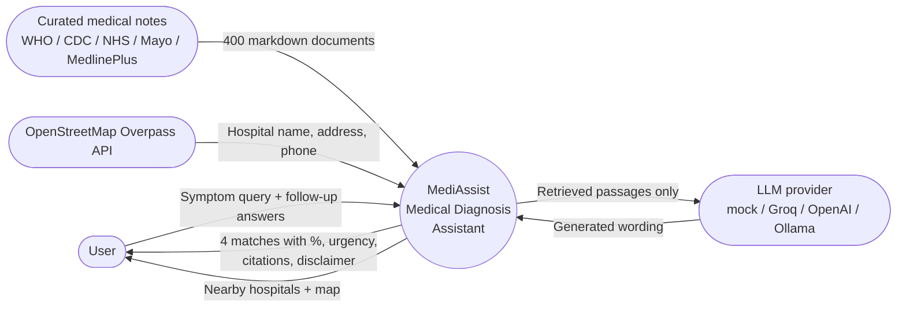
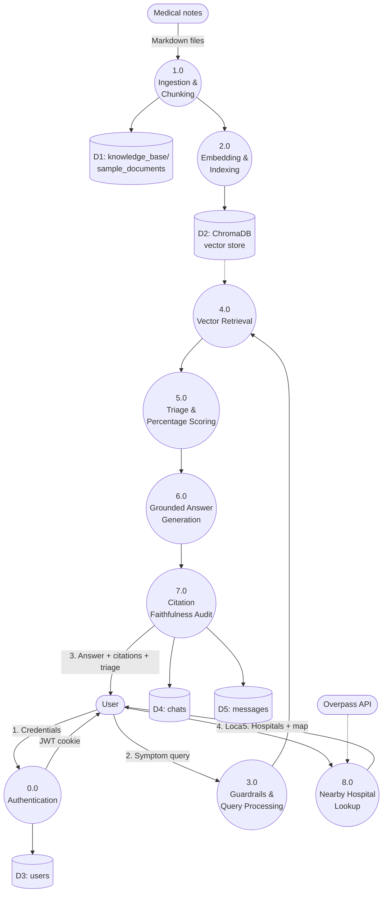
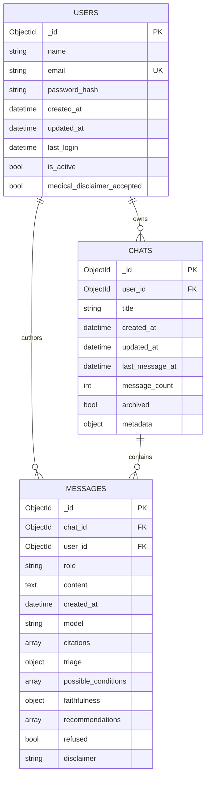
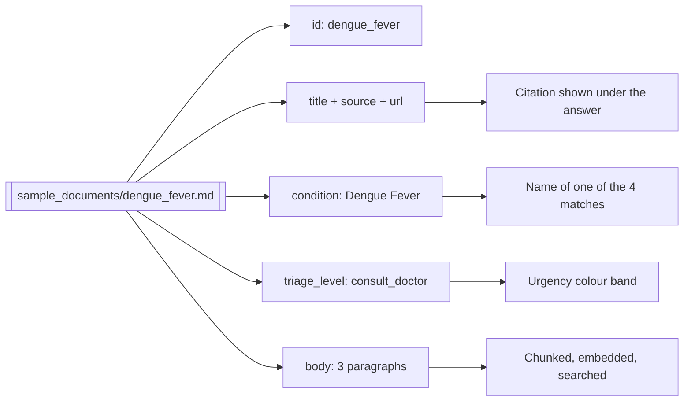
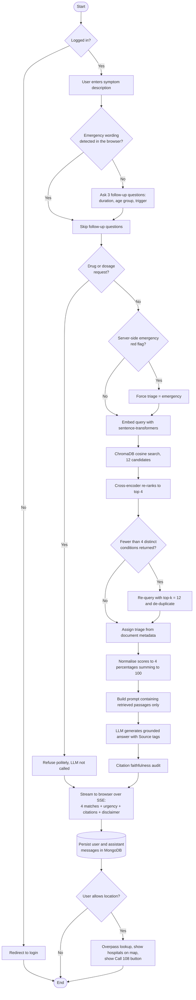

# Project Diagrams (Mermaid source)

These diagrams describe the system **as actually implemented in this
repository**, verified against the code. Paste any block into a mermaid live
editor (https://mermaid.live) to preview and export as PNG/SVG, or recreate
the same structure in draw.io for the final Word document.

> If your synopsis contains the earlier versions of these figures (FAISS,
> BM25 hybrid retrieval, Reciprocal Rank Fusion, confidence-threshold
> abstention, and an anonymised `QUERY_LOG` table), those describe the
> *proposed* design. Cross-encoder re-ranking **is** now implemented.
> See `docs/actual_implementation_report.md` for the full gap analysis.

---

## Figure 3.1 - System Architecture

```mermaid
flowchart TD
    subgraph INDEX["Indexing (offline, run manually via scripts/build_index.py)"]
        A1([400 curated medical notes<br/>knowledge_base/sample_documents/*.md]) --> A2[Front-matter parsing<br/>src/ingestion/loader.py]
        A2 --> A3[Word-window chunking<br/>120 words, 30-word overlap<br/>400 docs to 403 chunks]
        A3 --> A4[Embedding<br/>all-MiniLM-L6-v2 or S-PubMedBert]
        A4 --> A5[(ChromaDB persistent store<br/>cosine / HNSW<br/>data/vector_store_*)]
    end

    subgraph CLIENT["Frontend - React 19 + TypeScript + Vite"]
        C1([User describes symptoms]) --> C2[Follow-up questions<br/>duration, age group, trigger]
        C2 --> C3[POST /api/v1/chats/id/messages/stream]
        C9[Render: 4 matches with %,<br/>urgency, citations] --> C10[Geolocation -> nearby hospitals + map]
    end

    subgraph API["Backend - FastAPI"]
        C3 --> S1{JWT cookie valid?}
        S1 -- No --> S1a[401 Unauthorised]
        S1 -- Yes --> S2{Guardrails<br/>src/safety/guardrails.py}
        S2 -- "Drug / dosage request" --> S2a[Refuse, LLM never called]
        S2 -- "Emergency red flag" --> S2b[Force triage = emergency]
        S2 -- Normal --> S3[Embed query]
        S2b --> S3
        S3 --> S4[Vector search, 12 candidates]
        A5 -.-> S4
        S4 --> S4b[Cross-encoder re-ranker<br/>keep best 4]
        S4b --> S5[Triage from document metadata]<br/>src/safety/triage.py]
        S5 --> S6[match_percents<br/>largest-remainder, sums to 100]
        S6 --> S7[LLM generation using retrieved passages only<br/>mock / Groq / OpenAI / Ollama]
        S7 --> S8[Citation faithfulness audit]
        S8 --> S9[SSE stream: status, token,<br/>citation, triage, metadata, done]
        S9 --> C9
        S8 --> DB[(MongoDB<br/>users / chats / messages)]
    end

    C10 --> H1[GET /api/v1/hospitals/nearby]
    H1 --> H2[OpenStreetMap Overpass API<br/>Haversine distance, top 8]
```

---

## Figure 3.2 - Level 0 Data Flow Diagram (Context Diagram)



---

## Figure 3.3 - Level 1 Data Flow Diagram



---

## Figure 3.4 - Entity Relationship Diagram

The application database is MongoDB. The three collections below are created
in `backend/app/models/` and indexed in `backend/app/connection/indexes.py`.



**Indexes actually created:** unique on `users.email`;
`chats(user_id, updated_at desc)`, `chats(user_id, last_message_at desc)`,
`chats(user_id)`; `messages(chat_id, created_at asc)`, `messages(user_id)`,
`messages(chat_id)`.

> Privacy note, stated accurately: messages are **not** anonymised. Each
> message stores the `user_id` of its author so that chat history can be
> shown back to the correct logged-in user. Passwords are never stored in
> plain text (bcrypt hash only), and the JWT is held in an HTTP-only cookie
> so client-side JavaScript cannot read it.

---

## Figure 3.5 - Knowledge Base Document Structure

The 400 notes are plain markdown with a YAML-style front-matter block. Every
field is used by the running system, which is why citations and urgency can
be shown for any answer.



---

## Figure 3.6 - System Flowchart of the Query Answering Process


