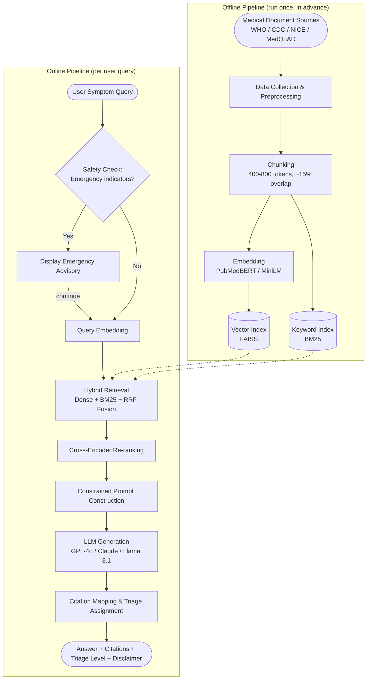
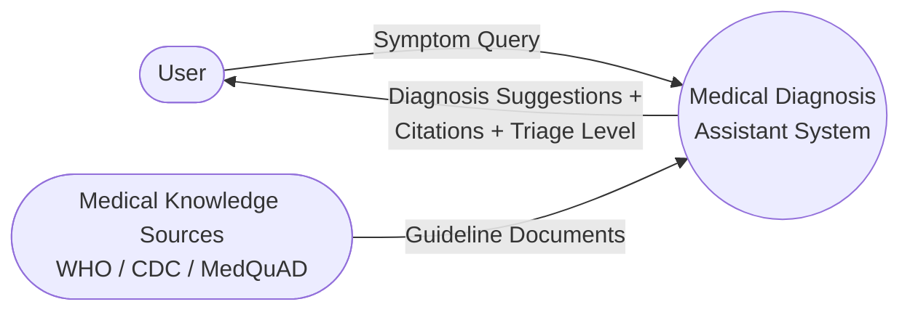
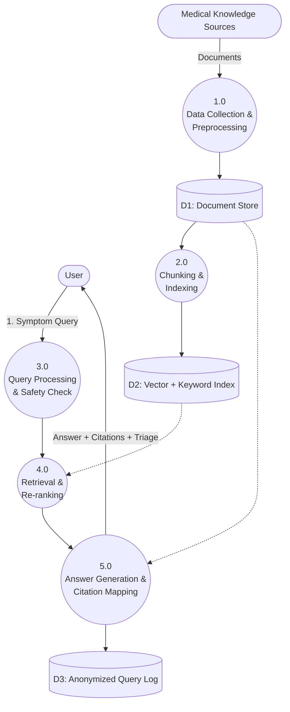
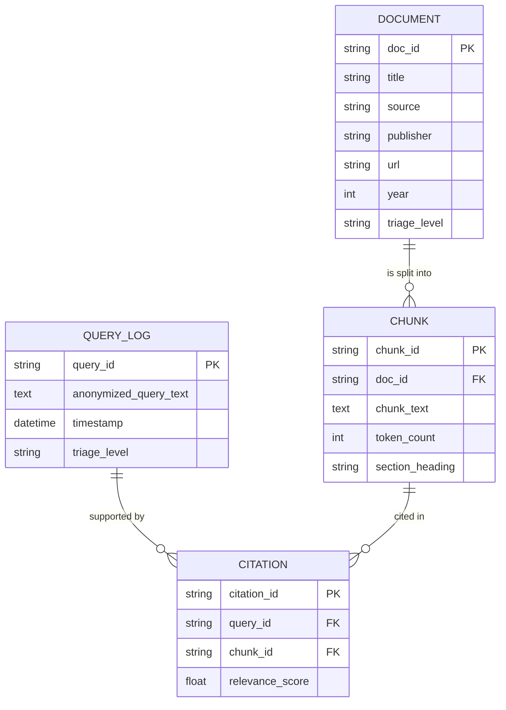

# Synopsis Diagrams (Mermaid source)

These are editable mermaid versions of Figures 3.1-3.5 referenced in the
project synopsis. Paste any block into a mermaid live editor
(https://mermaid.live) to preview and export as PNG/SVG, or recreate the
same structure in draw.io for the final Word document.

---

## Figure 3.1 - System Architecture of the Proposed Assistant



---

## Figure 3.2 - Level 0 Data Flow Diagram (Context Diagram)



---

## Figure 3.3 - Level 1 Data Flow Diagram



---

## Figure 3.4 - Entity Relationship Diagram



> Note: `QUERY_LOG` intentionally has no name, contact, or user-identifier
> field - only anonymized query text and system metrics are retained, per
> the privacy clarification in Sections 1.4 and 3.6.

---

## Figure 3.5 - System Flowchart of the Query Answering Process

```mermaid
flowchart TD
    START([Start]) --> Q1[User enters symptom<br/>description]
    Q1 --> C1{Emergency indicators<br/>detected?}
    C1 -- Yes --> E1[Display emergency advisory]
    E1 --> Q2
    C1 -- No --> Q2[Convert query to vector]
    Q2 --> Q3[Hybrid retrieval:<br/>dense search + BM25]
    Q3 --> Q4[Fuse rankings<br/>Reciprocal Rank Fusion]
    Q4 --> Q5[Cross-encoder re-ranking]
    Q5 --> C2{Retrieval confidence<br/>above threshold?}
    C2 -- No --> A1[Abstain:<br/>"insufficient evidence" message]
    A1 --> ENDX
    C2 -- Yes --> Q6[Build constrained prompt<br/>with top passages]
    Q6 --> Q7[LLM generates<br/>grounded answer]
    Q7 --> Q8[Map claims to citations]
    Q8 --> Q9[Assign triage level]
    Q9 --> Q10([Display answer + citations<br/>+ triage + disclaimer])
    Q10 --> ENDX([End])
```
